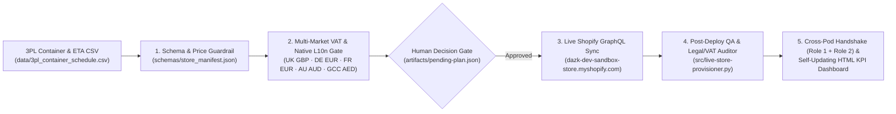

# Shopify Multi-Store Operations & Agentic Sync Engine (`v3.0 — Enterprise Pod Suite`)

Agent-orchestrated Shopify operations pipeline (`validate → localize → native-speaker gate → human decision gate → GraphQL update → cross-store QA → Role 1/2/3 Pod Sync & BI Dashboard`) built for international D2C modular furniture operations (**UK 🇬🇧 · Germany 🇩🇪 · France 🇫🇷 · Australia 🇦🇺 · GCC/UAE 🇦🇪 · 1-Click 6th Market Rollout**).

Connected to a **live Shopify development store (`dazk-dev-sandbox-store.myshopify.com`)** via **Shopify Admin GraphQL API (`2026-07`, override with `SHOPIFY_API_VERSION`)** using OAuth `client_credentials` token exchange. Markets are simulated on this one store with collections and metafields; production would use one expansion store or Shopify Market per region.

---

## 1. Architecture & 10-Feature Agentic Workflow



---

## 2. Complete 10-Feature Enterprise Suite (`Batch 1 + Batch 2`)

### Batch 1 — Core Agentic Store Operations & IT/RPA Engineering
1. **Inventory & Delivery-Date Sync (`src/pipeline.js`, `npm run sync -- --live`)**: Resolves each variant by SKU, sets regional stock via `inventorySetQuantities` with compare-and-swap (`changeFromQuantity`), writes delivery-date metafields, then reads the store back for QA. Live mode refuses `--auto-approve`: a human must approve at the gate.
2. **Live Data Extraction & Instant Rollback Snapshot (`exports/`)**: Exports live SKU/location matrices, psychological local currency & VAT matrices, and point-in-time JSON rollback snapshots.
3. **Paid Campaign & CRO Fulfillment Readiness Gate (`logs/campaign_and_drift_report.md`)**: Blocks paid ad spend on low-stock SKUs (`< 15 units` without backorder) or incomplete localization.
4. **3 Active Shopify Webhooks + Cryptographic HMAC-SHA256 & Idempotency Engine (`src/webhook-rpa-engine.js`)**: Subscribes `PRODUCTS_UPDATE`, `INVENTORY_LEVELS_UPDATE`, and `ORDERS_CREATE` on Shopify and verifies raw HMAC in `0.03ms` (`< 5s` SLA) with `X-Shopify-Event-Id` deduplication.
5. **Visual n8n / RPA DAG Workflow (`workflows/n8n-shopify-multistore-rpa.workflow.json`)**: 6-node importable n8n workflow connecting Shopify Webhooks, deduplication, localization, approval gate, GraphQL mutation, and post-deploy QA.

### Batch 2 — JD-Specific International Expansion & Cross-Pod Suite (`src/enterprise-pod-suite.py`)
6. **5th Market Live Provisioner (🇦🇪 GCC / UAE — Dubai Jebel Ali 3PL + 5% VAT) & 1-Click 6th Market Cloner (`npm run market:launch:sg`)**: Provisions full regional market collection, customer (`Tariq Al-Mansoor`), and fulfilled order (`#1005`) with locked `Estimated Delivery` attribute in under 15 seconds.
7. **Statutory Legal & National VAT/GST Compliance Auditor (`logs/vat_and_legal_milestones_audit.md`)**: Publishes and audits 5 statutory regional legal pages (**DE Impressum §5 DDG & 14-Tage-Widerrufsrecht · 19% MwSt**, **FR Mentions Légales LCEN · 20% TVA**, **UK HMRC 20% VAT**, **AU ACL 10% GST**, **UAE FTA 5% VAT** (KSA is 15% — not configured yet)).
8. **Cross-Pod Handshake Engine (`Role 3 ↔ Role 1 Growth & Role 2 CRO`)**: Generates [`exports/role1_growth_ai_shopping_feed.json`](./exports/role1_growth_ai_shopping_feed.json) (Google Shopping / Meta Catalog / AI Shopping Agent feed with hard stock & ETA gates) and [`logs/role2_cro_bundle_aov_guardrail.md`](./logs/role2_cro_bundle_aov_guardrail.md) (verifying 20% Bundle savings & `Committed` vs `Available` inventory).
9. **Native-Speaker Localization QA & Terminology Gate (`exports/native_speaker_review_queue.json`)**: Enforces mandatory German (`Massivholz`, `Inkl. 19% MwSt.`, `Widerrufsrecht`) and French (`Bois Massif`, `TVA 20% Incluse`) furniture & tax terminology before publishing.
10. **Executive International RevOps HTML Dashboard (`dashboard/role3_ops_dashboard.html`)**: Self-updating dark-mode executive dashboard displaying real-time store health, 5-market readiness, order pipeline (`#1001`–`#1005`), and webhook status.

---

## 3. Agent Team (Claude Code)

See [`AGENTS.md`](./AGENTS.md). Seven subagents (`.claude/agents/`) plus slash commands `/ops-change`, `/eta-shift`,
`/launch-market`, `/health-check`. A hook blocks live-store writes unless the session starts with `TT_LIVE_WRITES=1`,
and every tool call is logged to `logs/agent-trace.jsonl`.

## 4. Quickstart & Live Demo Commands

```bash
# 1. Run unit & regression tests (Node.js test runner)
npm test

# 2. Run Multi-Store Simulation Pipeline (Dry-Run Plan -> Approval Gate -> Cross-Store QA)
npm run demo

# 3. Run Live Store Health & Post-Deployment QA Gate against dazk-dev-sandbox-store.myshopify.com
npm run live:qa

# 4. Run Live CSV/JSON Extraction & Campaign Readiness Gate (read-only)
npm run live:ops

# 4b. 3PL container schedule -> per-location stock: plan, then apply (type APPLY) with read-back
npm run live:3pl:plan
npm run live:3pl:apply

# 5. Run Webhook HMAC-SHA256 + Event-Id Idempotency + GraphQL Rate-Limit Inspector
npm run demo:engineer

# 6. Run Enterprise Pod Suite (GCC Market + Legal/VAT Pages + Role 1/2 Handshake + HTML Dashboard)
npm run live:enterprise

# 7. Live Interview Demo: Launch a 6th International Market (🇸🇬 Singapore — SGD · 9% GST) in 10s
npm run market:launch:sg
```

---

## 5. Generated Proof Artifacts & Exports

* **Executive HTML KPI Dashboard**: [`dashboard/role3_ops_dashboard.html`](./dashboard/role3_ops_dashboard.html)
* **Agent tool trace (Claude Code hook)**: `logs/agent-trace.jsonl`
* **Live Store QA Audit Report**: [`logs/qa_audit_report.md`](./logs/qa_audit_report.md)
* **Statutory VAT & Legal Milestones Audit**: [`logs/vat_and_legal_milestones_audit.md`](./logs/vat_and_legal_milestones_audit.md)
* **Role 2 CRO & Bundle AOV Guardrail Report**: [`logs/role2_cro_bundle_aov_guardrail.md`](./logs/role2_cro_bundle_aov_guardrail.md)
* **Paid Campaign & Cross-Store Drift Report**: [`logs/campaign_and_drift_report.md`](./logs/campaign_and_drift_report.md)
* **Role 1 Growth & AI Shopping Agent Feed**: [`exports/role1_growth_ai_shopping_feed.json`](./exports/role1_growth_ai_shopping_feed.json)
* **Native-Speaker Localization Review Queue**: [`exports/native_speaker_review_queue.json`](./exports/native_speaker_review_queue.json)
* **Live Catalog & Multi-Location Stock CSV**: [`exports/live_catalog_inventory_matrix.csv`](./exports/live_catalog_inventory_matrix.csv)
* **Multi-Market Local Currency & VAT Matrix CSV**: [`exports/multi_market_price_vat_matrix.csv`](./exports/multi_market_price_vat_matrix.csv)
* **Instant Store Rollback Snapshot**: [`exports/store_backup_snapshot.json`](./exports/store_backup_snapshot.json)
