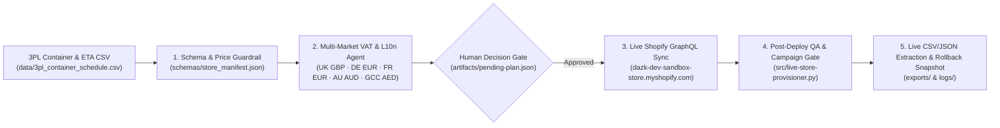

# Shopify Multi-Store Operations & Agentic Sync Engine (`v2.0`)

Agent-orchestrated Shopify operations pipeline (`validate → localize → human decision gate → GraphQL update → cross-store QA → live BI extraction`) built for international D2C modular furniture operations (**UK · Germany · France · Australia · GCC**).

Connected to a **Live Shopify Plus Storefront (`dazk-dev-sandbox-store.myshopify.com`)** via **Shopify Admin GraphQL API (`2025-01`)** using OAuth `client_credentials` token exchange.

---

## 1. Architecture & Agentic Workflow



---

## 2. Live Configured Storefront (`dazk-dev-sandbox-store.myshopify.com`)

| Dimension | Live Configuration on Shopify Plus Store |
| :--- | :--- |
| **Flagship Products (`6`)** | *Transformer Table 4.0 (1–12 Seater)*, *Transformer Bench 4.0 (1–6 Seater)*, *Transformer Coffee Table*, *Transformer Round Table*, *Stackable Dining Chairs (Set of 2)*, *Complete Dining Bundle (Save 20%)* |
| **Regional Variants & Stock** | **17 Hardwood Finish SKUs** (`Scandinavian Oak`, `Smoked Hickory`, `American Walnut`, `Brazilian Sequoia Batch #14`) — **462 units** distributed across **2 Warehouse Hubs** (`Western/EU/UK 3PL` & `APAC/VN Factory Hub`) |
| **Pinned Operational Metafields (`7`)** | `ops.fulfillment_mode`, `ops.estimated_delivery_window`, `ops.warehouse_hub`, `ops.vat_tax_class`, `localization.title_de`, `localization.title_fr`, `localization.multilingual_delivery_promise` |
| **Country Collections (`4`)** | 🇬🇧 `UK Market (GBP · 20% VAT)` · 🇩🇪 `Germany Market (EUR · 19% MwSt)` · 🇫🇷 `France Market (EUR · 20% TVA)` · 🇦🇺 `Australia Market (AUD · 10% GST)` |
| **Compliance & Shipping Pages (`3`)** | *International Shipping & Regional 3PL Hubs*, *Local Tax, VAT & Customs Compliance (UK HMRC · EU OSS · AU GST · GCC VAT)*, *International Storefronts & Localization Hub* |
| **Commercial Readiness** | 4 Regional Customer Profiles (`UK`, `DE`, `FR`, `AU`) + Active Promo Code `TT-INTL-BUNDLE15` (`15% Off`) |

---

## 3. Quickstart Commands

```bash
# 1. Run automated unit & regression tests (Node.js test runner)
npm test

# 2. Run Live Store Health & Post-Deployment QA Gate against dazk-dev-sandbox-store.myshopify.com
npm run live:qa

# 3. Run Live Data Extraction (CSV + JSON Rollback Snapshot) & Paid Campaign Readiness Gate
npm run live:ops

# 4. Run Multi-Store Simulation Pipeline (Dry-Run Plan -> Approval Gate -> Cross-Store QA)
npm run demo
```

---

## 4. Generated Proof Artifacts & Exports

* **Live Store QA Audit Report**: [`logs/qa_audit_report.md`](./logs/qa_audit_report.md)
* **Paid Campaign & Cross-Store Drift Report**: [`logs/campaign_and_drift_report.md`](./logs/campaign_and_drift_report.md)
* **Live Catalog, Multi-Location Stock & Localization Export**: [`exports/live_catalog_inventory_matrix.csv`](./exports/live_catalog_inventory_matrix.csv)
* **Multi-Market Local Currency & Baked-In VAT/GST Matrix**: [`exports/multi_market_price_vat_matrix.csv`](./exports/multi_market_price_vat_matrix.csv)
* **Instant Store Rollback Snapshot**: [`exports/store_backup_snapshot.json`](./exports/store_backup_snapshot.json)
* **Single Source of Truth Manifest**: [`schemas/store_manifest.json`](./schemas/store_manifest.json)
* **Operational Runbook**: [`RUNBOOK.md`](./RUNBOOK.md)
