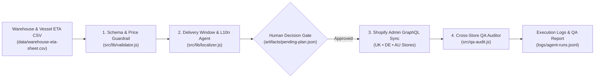

# Shopify Multi-Store Operations & Agentic Sync Engine

Agent-orchestrated Shopify operations pipeline (`validate → localize → human decision gate → GraphQL update → cross-store QA`) designed for international D2C brands running regional **Shopify Expansion Stores**.

Replaces manual inventory & delivery-date spreadsheet edits with versioned JSON schemas, **Shopify Admin GraphQL API (`2025-01`)** batch updates, localized delivery-date `Metafields`, and automated cross-store regression checks.

---

## Architecture & Agentic Workflow



## Regional Storefront Matrix

| Market | Storefront Currency | Locale | Tax Configuration | Theme Git Branch |
| :--- | :--- | :--- | :--- | :--- |
| **United Kingdom (`UK`)** | `GBP` (£) | `en` | 20% VAT-inclusive | `storefront/UK_Live` |
| **Germany (`DE`)** | `EUR` (€) | `de` | 19% MwSt-inclusive | `storefront/DE_Live` |
| **Australia (`AU`)** | `AUD` ($) | `en` | 10% GST-inclusive | `storefront/AU_Live` |

---

## Quickstart (Zero External Dependencies — Node.js 20+)

```bash
# 1. Run automated unit & QA tests
npm test

# 2. Run full pipeline in safe dry-run demo mode (with auto-approval)
npm run demo

# 3. Run interactive pipeline (pauses at Human Approval Decision Gate)
npm run sync

# 4. Run Cross-Store QA Auditor against a baseline snapshot containing real-world regressions
npm run qa
```

## What the Cross-Store QA Gate Catches (`src/qa-audit.js`)

1. **`LEAKED_TEST_PRODUCT` (`CRITICAL`)**: Detects active draft/staging/test SKUs accidentally published to a live regional storefront.
2. **`TRACKING_CURRENCY_MISMATCH` (`HIGH`)**: Catches hardcoded `'USD'` conversion scripts copied from North American themes onto `GBP` / `EUR` / `AUD` storefronts.
3. **`MISSING_DELIVERY_DATE_METAFIELD` (`HIGH`)**: Ensures every active SKU displays an accurate `custom.estimated_delivery_badge` metafield.
4. **`UNROUNDED_RETAIL_PRICE` (`MEDIUM`)**: Flags awkward tax-converted prices (e.g. `£1,428.57`) before they reach customers.

---

## Repository Structure

* `schemas/stores.config.json` — Single source of truth for regional currencies, VAT/GST rates, customs buffers, and allowed price endings.
* `schemas/inventory-feed.schema.json` — JSON Schema contract for warehouse stock & container ETA feeds.
* `src/pipeline.js` — Main orchestrator (`validate → plan → approve → sync → QA`).
* `src/lib/shopify-graphql.js` — Shopify Admin GraphQL (`2025-01`) mutations (`inventorySetQuantities`, `metafieldsSet`, `translationsRegister`).
* `src/qa-audit.js` — Automated post-deployment storefront health auditor.
* `RUNBOOK.md` — Plain-language operational runbook, rollback playbook, and new-market onboarding checklist.
